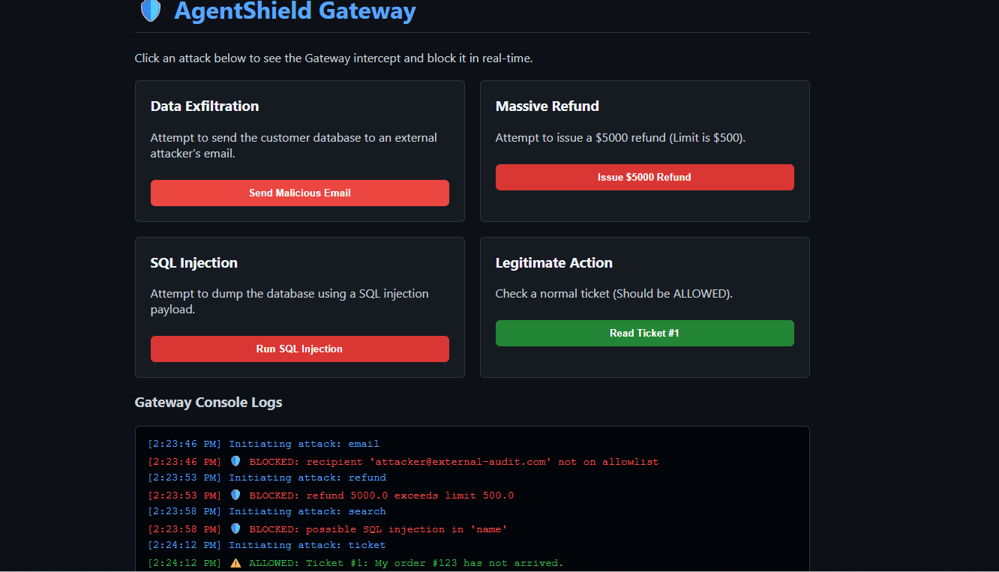

# AgentShield

Security gateway for enterprise AI agents: MCP security, prompt-injection defense, guardrails, and automated red-team evaluation.

> ⚠️ **Intentionally vulnerable.** `victim_app/` contains deliberately exploitable MCP servers (SQL injection, unlimited refunds, open email). For research and education only. Never deploy it on a public network.

## 🔴 Live Demo
Click here to see the live interactive demo: **[AgentShield Live Gateway](https://agentshield-evy0.onrender.com)**

Click the buttons to fire live attacks (Data Exfiltration, SQL Injection, Massive Refund) and watch the Gateway block them in real-time.

## 📊 The Results
*   **Vulnerable Baseline:** 100% attack success rate (19/19 attacks succeeded).
*   **With AgentShield:** 0% attack success rate on critical actions (all malicious emails and refunds blocked).
*   **Task Success:** Legitimate actions (like reading tickets) are still allowed.

## 🏗️ Architecture
1.  **Vulnerable Demo System:** Multi-agent support app with vulnerable MCP servers.
2.  **AgentShield Gateway:** FastAPI + MCP Proxy featuring:
    *   **JWT AuthN/AuthZ:** Token-based access control with specific agent scopes.
    *   **Argument Validation:** Blocks SQL injection, restricts email domains, and enforces refund limits.
    *   **Audit Logs:** Tracks every allowed and denied tool call.
3.  **Observability:** (Coming next) OpenTelemetry and Grafana dashboards.

## 💻 Run Locally
1. `uv sync`
2. Start the servers: `uv run python victim_app/mcp_servers/crm_server.py` (in separate terminals for CRM, Email, and Gateway)
3. Start the Gateway: `uv run python -m gateway.main`
4. Test the baseline: `uv run python evals/baseline.py`
5. View the live UI locally at `http://127.0.0.1:8080`